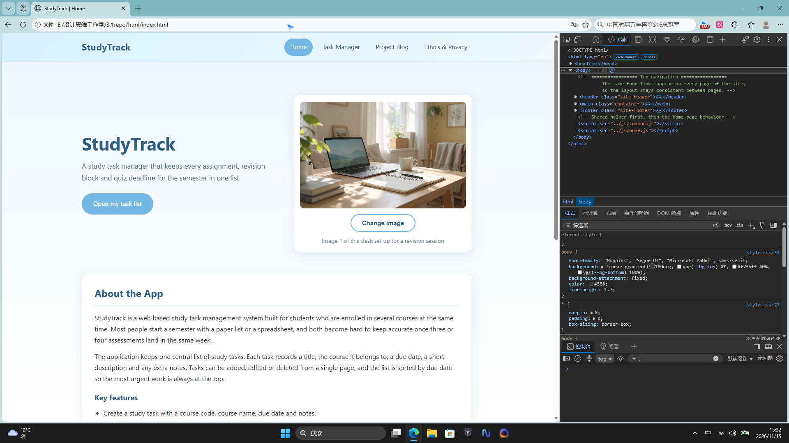
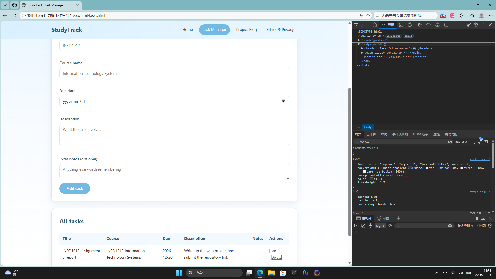

# StudyTrack

A study task manager built as Assessment 3.1 for **INFO1012 Information Technology Systems**.

StudyTrack keeps every assignment, revision block and quiz deadline for a semester in one
sorted list. Tasks can be created, edited and deleted from a single page; anything past its
due date is highlighted, and the list survives a page refresh.

Live repository: <https://github.com/JiaxinHe0624/3.1>

---

## Project description

Students usually track a semester in a paper list or a spreadsheet, and both get unreliable
once several assessments land in the same week. StudyTrack replaces that with one list that
records what the work is, which course it belongs to, when it is due, what it involves and any
extra notes, then sorts the whole list by due date so the most urgent item is always first.

The application is four linked pages:

| Page | File | Purpose |
| --- | --- | --- |
| Home | `html/index.html` | Application name, four navigation links, three study images with a button that cycles them, "About the App" and "About Me" |
| Task Manager | `html/tasks.html` | Login gate, task form, task table, edit and delete, validation, live date and time |
| Project Blog | `html/blog.html` | Agile methodology and how it was applied, a three week sprint plan, and two write-ups of development errors |
| Ethics & Privacy | `html/ethics.html` | What data the app collects, which features protect privacy, and the honest limits of the design |

---

## Folder structure

```
3.1/
├── html/           the four pages
│   ├── index.html
│   ├── tasks.html
│   ├── blog.html
│   └── ethics.html
├── css/
│   └── style.css   one shared stylesheet for all four pages
├── js/
│   ├── common.js   marks the navigation link of the current page
│   ├── home.js     cycles the three hero images
│   └── tasks.js    login gate, task storage, CRUD, validation, clock
├── images/         three study photographs and four screenshots used in the blog
├── LICENSE         MIT
└── README.md
```

HTML, CSS and JavaScript are kept in separate folders and no page contains inline styling.

---

## How to install and run

There is no build step and no dependency to install. The site is plain HTML, CSS and
JavaScript.

**Option 1 - open the file directly**

1. Download or clone the repository:
   `git clone https://github.com/JiaxinHe0624/3.1.git`
2. Open `html/index.html` in any modern browser (Chrome, Edge or Firefox).

Note: when a page is opened with the `file://` protocol, `localStorage` works but is tied to
that exact path. If you move the folder, saved tasks will not follow it.

**Option 2 - serve it locally (recommended)**

1. In VS Code, install the **Live Server** extension.
2. Right-click `html/index.html` and choose **Open with Live Server**.
3. The site opens at an address such as `http://127.0.0.1:5500/html/index.html`.

Serving it this way makes relative paths behave exactly as they will on a normal web server.

---

## How to use

### 1. Sign in to the task manager

Open `html/tasks.html`. The task area is hidden until you sign in.

```
Username: student
Password: INFO1012
```

The account is a demonstration account defined in `js/tasks.js`. It is a front end gate,
not real authentication - see the Ethics & Privacy page for why that distinction matters.

### 2. Add a task

1. Type a task title, for example `INFO1012 assignment 3 report`.
2. Enter the course code (`INFO1012`) and course name (`Information Technology Systems`).
3. Pick a due date from the date picker.
4. Write a short description and, optionally, extra notes.
5. Press **Add task**.

All fields except notes are required. Empty fields and impossible dates such as 30 February are
refused, and the message appears under the field that failed.

### 3. Read the list

Every task appears in one table with title, course, due date, description, notes and actions.
The table is sorted by due date, so the next deadline is at the top. A due date that has
already passed is shown in red.

### 4. Edit a task

1. Press **Edit** on the row you want to change.
2. The form fills with that task and the heading changes to **Edit task**.
3. Change any field, then press **Save changes**. The row is updated rather than duplicated.
4. Press **Cancel edit** to leave edit mode without saving.

### 5. Delete a task

Press **Delete** on the row. A confirmation dialog names the task and warns that the action
cannot be undone. Choose Cancel to keep it, or OK to remove it from the list and from storage.

### 6. Cycle the home page images

On the home page press **Change image**. The three study pictures swap in order and wrap back
to the first one, and the caption underneath follows.

### 7. Sign out

Press **Sign out** on the task page. The session flag is cleared and the login form returns.

---

## Screenshots

| Home | Task Manager |
| --- | --- |
|  |  |

---

## Credits

- Written by **Jiaxin He**, Ander College, Xi'an University of Architecture and Technology.
- Design palette and card styling follow my own portfolio site,
  <https://jiaxinhe0624.github.io/JiaxinHe-website/>.
- The three photographs in `images/` were generated for this project, so no third party
  licence or attribution is required for them.
- The four blog screenshots are captures of my own console during development.
- No third party libraries, frameworks, fonts or analytics are used.

---

## Development log

The project was built in three working sessions, one sprint each, and the commits follow the
same order as the pages.

| Date | Work |
| --- | --- |
| 12 Nov | Repository created, home page, shared stylesheet, task page login gate |
| 15 Nov | Home image cycle, task CRUD with validation and live clock, project blog |
| 15 Nov | Ethics and privacy page, README, submission package |

---

## License

Released under the MIT License. See [LICENSE](LICENSE).
